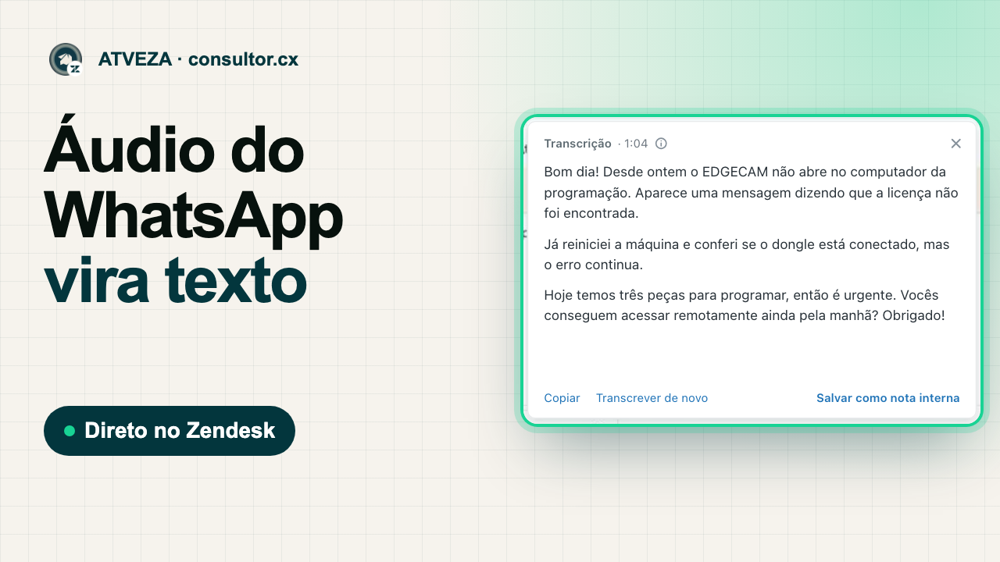

# Como transcrever áudios do WhatsApp no Zendesk com Whisper

**Transcrever Áudio para Zendesk**, da ATVEZA, é uma extensão Chrome (Manifest V3) que transcreve, no computador do agente, os áudios de WhatsApp que chegam aos tickets do Agent Workspace do Zendesk. O modelo Whisper roda no navegador (WebGPU, com WASM como reserva): o áudio não sai da máquina e não há custo por transcrição.

## Leia os áudios do WhatsApp sem sair do Zendesk

**Transforme mensagens de voz em texto e mantenha o foco no atendimento.** Feita para equipes de suporte e CX que recebem áudios de WhatsApp no Zendesk, a extensão permite consultar a mensagem no próprio ticket e registrar a transcrição para os próximos atendimentos.

### O que sua operação ganha

- **Mais fluidez no atendimento:** leia a mensagem quando não puder ouvir o áudio ou estiver sem fone.
- **Contexto para a equipe:** salve a transcrição como nota interna privada para facilitar consultas e a continuidade do atendimento.
- **Menos tarefas manuais:** copie o texto ou registre a nota com um clique.
- **Privacidade no processamento:** o Whisper roda no computador do agente, sem enviar o áudio a uma API externa de IA.
- **Sem cobrança por transcrição:** o processamento local dispensa consumo de uma API paga de transcrição.

### Veja a demonstração

[](https://www.youtube.com/watch?v=OIFcG6mKv1o)

▶️ **[Assistir ao vídeo no YouTube](https://www.youtube.com/watch?v=OIFcG6mKv1o)**

### Comece a usar

[Veja o guia de instalação e transcrição no consultor.cx](https://consultor.cx/transcrever-audio-zendesk).

1. **[Instale a extensão pela Chrome Web Store](https://chromewebstore.google.com/detail/fppeheopbmnnoagoekmllmmohfdncfdf)** e abra um ticket com áudio no Agent Workspace do Zendesk.
2. Clique em **⋯** ao lado do áudio e escolha **Transcrever**.
3. Leia o texto no ticket e, se desejar, **copie ou salve como nota interna privada**.

Na primeira utilização, a extensão baixa o modelo de IA e o mantém no navegador. O desempenho depende do computador: WebGPU acelera o processamento; sem ela, a extensão usa WASM como alternativa. A transcrição é gerada por IA e deve ser conferida antes de ser usada no atendimento.

### Quer levar essa solução para sua equipe?

Precisa de apoio para avaliar o uso na sua operação, orientar agentes ou adaptar a implantação? **[Conheça a consultoria em Zendesk e CX da ATVEZA](https://consultor.cx)** ou fale com **[athos@atveza.com](mailto:athos@atveza.com)**.

[Consulte a política de privacidade](https://consultor.cx/politica-de-privacidade#transcrever-audio-zendesk).

---

- **Instalar:** [Chrome Web Store](https://chromewebstore.google.com/detail/fppeheopbmnnoagoekmllmmohfdncfdf) (versão 0.3.0, qualquer conta do Zendesk)
- Especificação (fonte da verdade): [`docs/especificacao-tecnica.md`](docs/especificacao-tecnica.md)
- Relatório da Fase 0: [`docs/fase-0-relatorio.md`](docs/fase-0-relatorio.md)
- Relatório da Fase 1: [`docs/fase-1-relatorio.md`](docs/fase-1-relatorio.md)
- Piloto SKA (Fase 3): [`docs/piloto-ska.md`](docs/piloto-ska.md) · loja: [`docs/chrome-web-store.md`](docs/chrome-web-store.md) · privacidade: [`docs/politica-de-privacidade.md`](docs/politica-de-privacidade.md) · DPO: [`docs/lgpd-dpo.md`](docs/lgpd-dpo.md)

> Mantenha o projeto fora de pastas sincronizadas (iCloud, Drive). O macOS pode tirar arquivos do disco e travar o build.

## Status

| Fase               | Status                                                                                                      |
| ------------------ | ----------------------------------------------------------------------------------------------------------- |
| 0 · Descoberta     | ✅                                                                                                          |
| 1 · Teste do motor | ✅ Modelo padrão: whisper-large-v3-turbo (falta medir numa máquina típica de agente)                        |
| 2 · MVP completo   | ✅ Testado no Zendesk real (d3v-atveza, ticket 454): ⋯, transcrição, nota interna privada                   |
| 3 · Piloto na SKA  | 🚧 Material pronto (build, loja, privacidade, DPO, guia); falta bancada na máquina do agente e os 20 áudios |
| 4 · Liberação      | ✅ 0.3.0 publicada na Chrome Web Store em 20/11/2026                                                        |

## Requisitos

- Node.js 22 (`.nvmrc`)
- Google Chrome ou Edge 124 ou superior

## Desenvolvimento

```bash
npm install
npm run dev          # abre um Chrome com a extensão e recarrega a cada mudança
npm run build        # gera .output/chrome-mv3 (build "dev": d3v-atveza e pdi-atveza)
npm run build:store  # versão da loja: qualquer conta *.zendesk.com (clients/public.json)
npm run store:assets # zip + ícone + capturas na pasta publicacao/
npm run build:ska    # versão restrita à SKA em .output-ska/ (clients/ska.json)
npm run check        # lint + formatação + tipos + testes + build
npm run test:e2e     # Playwright com a extensão carregada (baixa o modelo na 1ª vez)
npm run bench        # bancada da Fase 1 (abre um Chromium visível)
```

### Carregar a extensão no Chrome

1. `npm run build`
2. Abra `chrome://extensions` e ligue o **Modo do desenvolvedor**.
3. Clique em **Carregar sem compactação** e escolha a pasta `.output/chrome-mv3`.
4. Depois de cada novo build, clique em ↻ no card da extensão e recarregue a aba do Zendesk.

### Modo descoberta (Fase 0)

1. Nas opções da extensão, ligue **Modo descoberta**.
2. Abra tickets com áudio no Zendesk. No console da página aparecem linhas `[atveza] discovery`.
3. Nas opções, clique em **Copiar relatório de descoberta**. O relatório não tem nomes, textos nem URLs de clientes.

## Estrutura

```
clients/            # configuração por cliente (subdomínios, dicionário)
entrypoints/
  content/          # content script: observa a página e detecta os áudios
  options/          # página de opções (Preact)
src/shared/         # seletores, configurações, descoberta, utilitários
tests/
  fixtures/         # estrutura anonimizada do Agent Workspace
  unit/             # Vitest + jsdom
docs/               # especificação e relatórios por fase
```

## Regras do projeto

As regras da seção 15 da especificação valem para todo o código. As principais:

- Nenhum seletor do Zendesk fica fixo no código: todos vêm de `selectors.default.json`.
- Nenhum código remoto, telemetria ou API de IA externa.
- O texto da transcrição entra na página só via `textContent` (o ESLint bloqueia `innerHTML`).
- Interface em português do Brasil; código e comentários em inglês.
